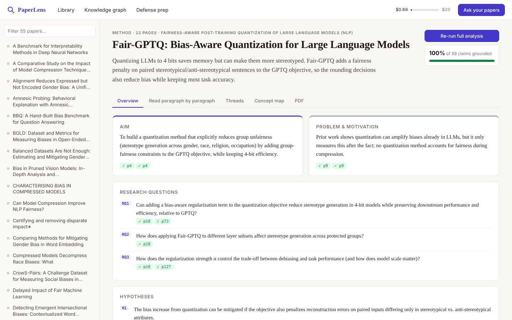
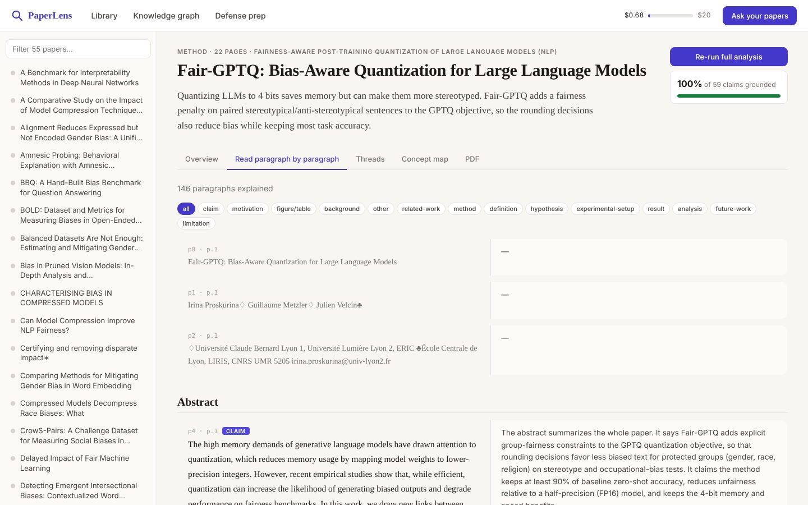
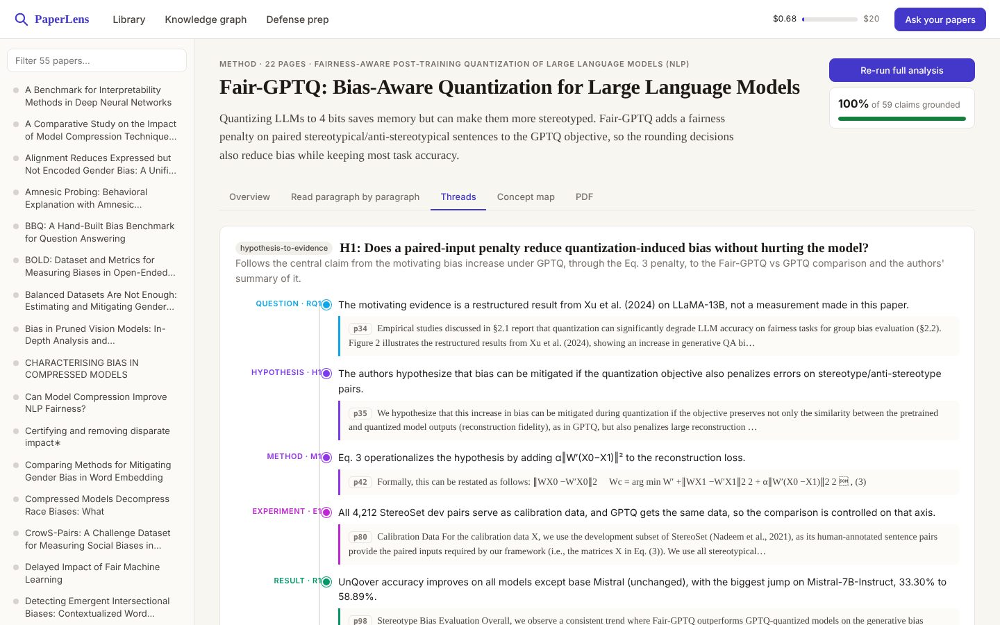
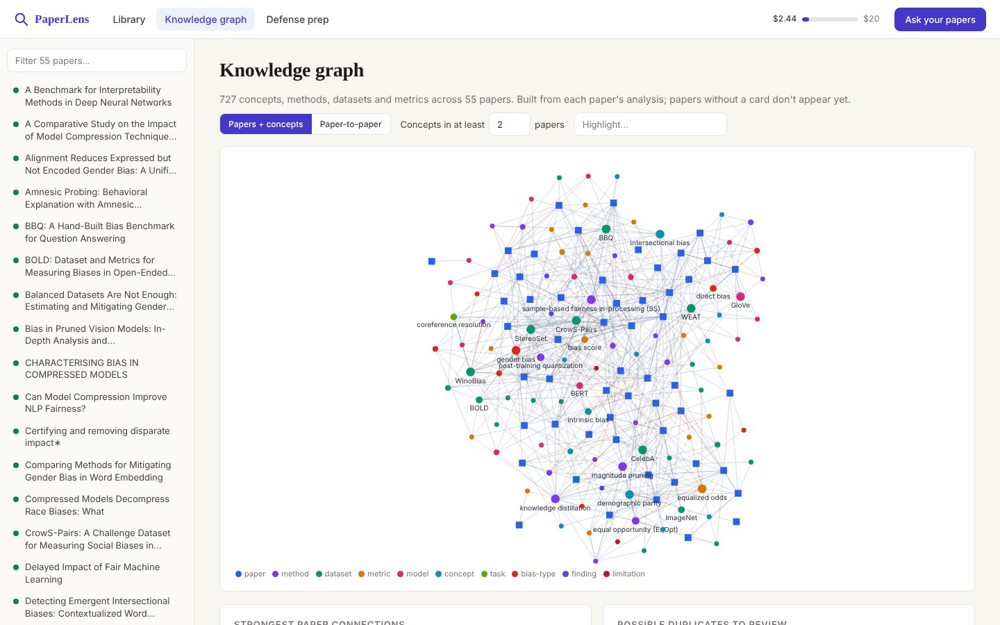
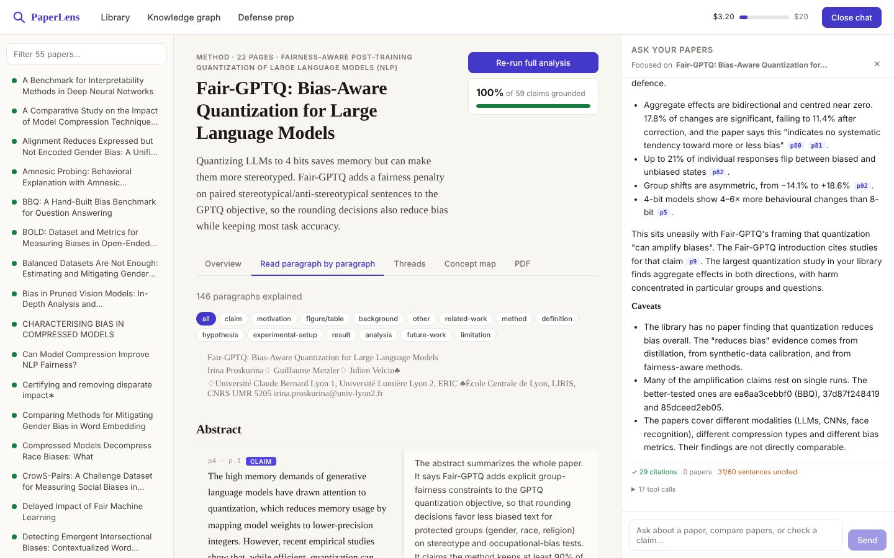
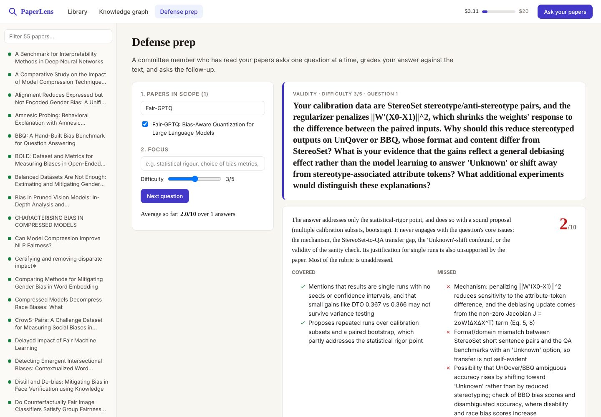
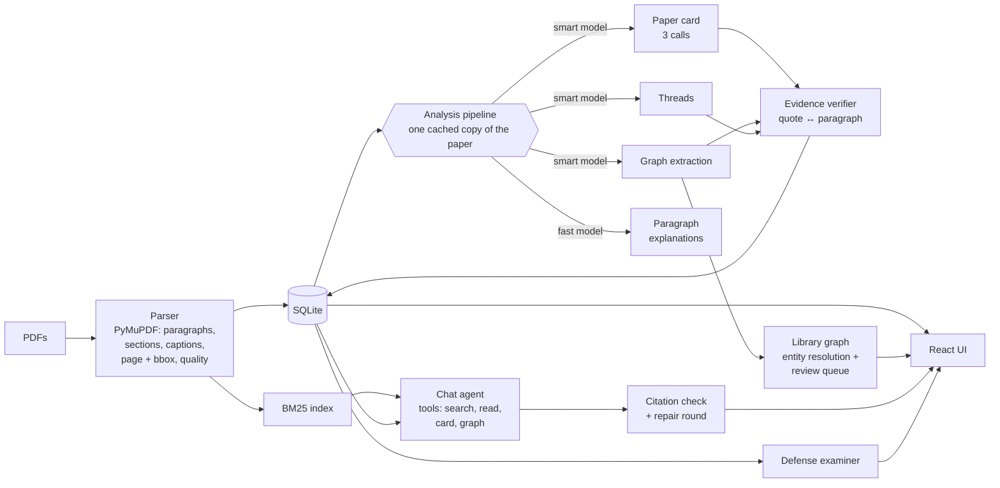

# PaperLens

**Understand research papers paragraph by paragraph, with every claim grounded in the text.**

PaperLens is a Claude-powered research agent for reading papers deeply and preparing to defend them. Drop in PDFs and it builds:

- **A guided reader.** Every paragraph sits next to a plain-language explanation, its role in the argument (motivation, method, result, limitation…), key terms, and links to the paragraphs it depends on.
- **A paper card.** Aim, research questions, hypotheses (stated *or* inferred), methodology, how each experiment was run, **how each result is reported** (which table, seeds, error bars, significance tests), and limitations, split into *what the authors admit* and *what a committee would raise*.
- **Threads.** Idea chains traced through the paper: question → hypothesis → method → experiment → result → limitation, with a blunt verdict on whether the evidence establishes the claim.
- **A knowledge graph** across your whole library (methods, datasets, metrics, bias types, findings), with paper-to-paper links.
- **A tool-using chat agent** that answers only from your papers and cites `[paper:paragraph]` for every claim.
- **Defense prep**: a committee examiner that asks one question at a time, grades your answer against the papers, shows what you missed, and asks the follow-up.

| Paper card (aim → hypotheses → experiments → results → limitations) | Paragraph-by-paragraph reader |
|---|---|
|  |  |
| **Threads: hypothesis traced to evidence** | **Knowledge graph across 55 papers** |
|  |  |
| **Chat agent: every claim cited, honesty meter** | **Defense examiner: graded against the text** |
|  |  |

---

## The failure it's designed against: confident, plausible fabrication

An LLM asked "what are this paper's limitations?" will write a convincing list, and some items won't be in the paper. In a thesis defense, repeating one of those is worse than saying nothing. So PaperLens treats grounding as the core feature, not a footnote:

1. **Every claim carries evidence.** Each card field, graph edge and thread step comes with `{pid, quote}` pairs.
2. **Every quote is checked mechanically** against the paragraph it cites (`backend/paperlens/verify.py`). Claims whose quotes don't verify stay visible but are marked **unverified**, in red, and the grounding rate is shown on every paper.
3. **The chat agent can only cite what it read.** It retrieves paragraphs through tools. If its answer cites a paragraph it never retrieved, it gets one repair round, and anything still invalid is surfaced as such.
4. **It is allowed to say "the papers don't state this."** Retrieval reports an IDF-weighted coverage score, and the agent is told when matches are weak.
5. **Paper text is data, never instructions.** It's wrapped and labelled in the prompt (prompt-injection guard).

### What broke while building it (and the fix)

| What broke | How I found it | Fix |
|---|---|---|
| **The quote checker accepted meaning-flipped quotes.** Character-level fuzzy matching scored "bias *decreases*" against "bias *increases*" at >0.9. | A synthetic adversarial eval (real quotes vs. word-swapped, cross-paragraph and invented ones): only **62%** of swapped quotes were rejected, precision 0.72. | A token-level aligner that tolerates PDF noise (ligatures, hyphenation) but rejects any whole-word substitution, especially negations, direction words and numbers. Now **100%** of swapped quotes are rejected, precision **1.00**, recall 0.98. |
| **Prompt caching silently did nothing.** Three card calls each re-wrote the 28k-token paper to the cache. | Cost ledger: `cache_read = 0` on every call. | Constrained-JSON mode puts the schema in the cached prefix, so each stage's different schema invalidated it. Moving the schema after the cached paper got a **100%** cache-read rate on later stages and cut card cost by 55%. (Small models still use constrained decoding, where cache writes are cheap and JSON reliability matters more.) |
| **Forced tool calls and `temperature` were rejected** by the current models. | 400 errors on first real run. | Switched structured output to `output_config` JSON schemas with a schema adapter (closed objects, numeric bounds moved to descriptions). |
| **One schema was too big to compile** ("compiled grammar is too large"). | 400 error. | Split the card into three calls over the same cached paper; fall back to schema-in-prompt if a schema still won't compile. |
| **The agent's tool loop re-paid for the whole conversation every step:** $0.38 per question. | Ledger per purpose. | A rolling cache breakpoint on the newest turn: **$0.16** for the same question (−59%). |
| **The "no answer" signal was fooled by common words:** "what *data* was *used* to *train*…" matched everything. | Trap-question eval: 75% detection. | IDF-weighted term coverage: **100%** of trap questions flagged (including in-domain traps), while every answerable question stays above the threshold. |
| **Long batches truncated:** dense paragraphs blew the output limit. | `max_tokens` stop reason. | Batches split in half automatically and retry; progress is saved after every batch. |
| **Extraction calls kept running out of tokens, and the library run took 4 min per paper.** About 1 in 4 graph extractions failed even after a "smaller" retry. | Raw response inspection: the content started with a `thinking` block. The 5.5 models think adaptively by default, and hidden reasoning was eating the `max_tokens` budget on schema-filling tasks. | Thinking is disabled for bulk extraction on the small model (kept for deep reads, chat and the examiner, where reasoning pays off). The library pass went from ~3.5 min to **~30 s per paper**, with **0 failures**, at ~$0.01 per paper. |
| **A paper's cache expired mid-analysis** during a 5-minute Haiku pass. | `cache_write` reappeared on the threads stage. | Reordered stages so all the large-model steps run back to back while the cache is warm. |

## Evaluation

Run `python -m paperlens eval` (free) or `python -m paperlens eval --llm` (calls Claude). Results on a 55-paper library on fairness and bias in compressed models (1,000+ pages):

| Eval | What it measures | Result |
|---|---|---|
| Parser | Abstract / Introduction detected; pages with clean text | 100% / 94.5% / 94.2% |
| Quote verifier (400 synthetic cases) | Precision / recall; rejection of meaning-flipped, cross-paragraph and invented quotes | **1.00** / 0.98; 100% / 100% / 100% |
| Retrieval (26 answerable + 12 trap questions) | Source paper in top-5; "not in library" signal on traps | **100%**; **100%** (including 4 in-domain traps) |
| Grounding (55 papers, 4,763 extracted claims) | Claims whose evidence quote verified against the cited paragraph | **96.5%** |
| Chat agent, end to end (12 questions, `--llm`) | Answerable questions answered with citations; traps correctly declined; invalid citations; false refusals | **100%**; **100%** (4/4 hard traps); **0%**; **0%** |

An honest weak spot: **56%** of chat-answer sentences carry no citation. Many are headings, transitions and syntheses ("this sits uneasily with…"), but the checker can't yet tell those from unsupported claims. The next step is sentence-level claim detection with entailment checks against the cited paragraph.

## Architecture



| Piece | Where | Notes |
|---|---|---|
| PDF parsing | `backend/paperlens/parse.py` | Column-aware ordering, cross-column paragraph re-joining, header/footer/margin-stamp removal, figure-text detection, per-page quality score |
| LLM client | `backend/paperlens/llm.py` | Prompt caching, structured JSON (constrained or schema-in-prompt), cost ledger, hard budget cap |
| Analysis | `backend/paperlens/analyze.py` | Card (3 parts), graph, threads, paragraph explanations (adaptive batches) |
| Verification | `backend/paperlens/verify.py` | Quote alignment + chat citation checks |
| Graph | `backend/paperlens/graph.py` | Alias-based entity merging; near-duplicates go to a review queue instead of auto-merging (a wrong merge invents connections between papers) |
| Agent | `backend/paperlens/agent.py` | Tool loop (search / read / card / graph), grounding contract, repair round, defense examiner |
| API | `backend/paperlens/app.py` | FastAPI; a single worker queue analyses papers serially |
| UI | `frontend/` | React + TypeScript + Vite: library, reader, card, threads, force-directed graphs, chat, defense |

## Cost

All costs are measured from the built-in ledger (Claude 5.5 models, USD):

| What | Model | Cost |
|---|---|---|
| Quick card + graph, per paper | Haiku 5.5 | ~$0.01 |
| Deep read of a 22-page paper (card, graph, threads, every paragraph explained) | Sonnet 5.5 + Haiku 5.5 | ~$0.45 |
| One multi-paper research question (5 tool calls) | Sonnet 5.5 | ~$0.16 |
| One defense question + grading | Sonnet 5.5 | ~$0.15 |
| **Everything above for the 55-paper library, including all development runs** | | **$3.31** |

`PAPERLENS_BUDGET_USD` sets a hard cap; everything stops cleanly when it's reached, and partial results are kept.

## Quick start

Requirements: Python 3.10+, Node 18+, an Anthropic API key.

```bash
git clone https://github.com/kishanguptab/paper_reader && cd paper_reader
cp .env.example .env            # add ANTHROPIC_API_KEY
mkdir papers && cp ~/path/to/*.pdf papers/
./start.sh                      # sets up venv + UI, opens http://localhost:8000
```

In the app: **Build cards + graph for all papers** (cheap skim of the whole library), then open any paper and **Analyze this paper** for the deep read.

CLI:

```bash
cd backend
python -m paperlens ingest
python -m paperlens analyze all --stages card,graph --quick --workers 4   # library skim on the fast model
python -m paperlens analyze <paper_id>                                      # deep read
python -m paperlens ask "Which papers find compression amplifies bias?"
python -m paperlens eval            # parser / verifier / retrieval / grounding evals (free)
python -m paperlens cost
```

Development: `cd backend && pytest` (no network: a scripted fake Claude drives the whole pipeline); `cd frontend && npm run dev` (Vite on :5173, proxied to the API on :8000).

## Limitations and next steps

- Parsing is heuristic. Equations and complex tables come through as flattened text; scanned PDFs are flagged but not OCR'd.
- Retrieval is lexical (BM25). That's transparent and dependency-free, but a hybrid with embeddings would catch paraphrased queries.
- The quote verifier proves a quote *exists* in the cited paragraph, not that it *supports* the claim. An entailment check (NLI or an LLM judge) is the next layer.
- Entity resolution is string- and alias-based; the review queue is display-only for now.

---
Built by Kishan Gupta with Claude.
